# Microsoft Fabric Exploratory Sandbox

### Overall Estimated Duration: Self-paced (available for the full term)
#### Last Updated: 13th November 2026

## 📖 Sandbox Overview

This sandbox gives you your own environment to explore Microsoft Fabric. There are no step-by-step exercises, preloaded datasets, or preconfigured resources. You bring your own data and coursework, and use the environment to build, test, and learn at your own pace.

## 🧰 What Is Included

- **A Windows virtual machine** with the following software installed:
  - Power BI Desktop
  - Microsoft Excel (desktop)
  - DAX Studio
  - Tabular Editor 2
  - SQL Server Management Studio (SSMS)
  - Microsoft Edge
- **A Microsoft Fabric capacity** in your Azure resource group, with you as the capacity administrator.
- **An Azure account** that you use to sign in to the Azure portal and to Microsoft Fabric.

## 🎯 What You Can Do

- **Data Factory:** Build pipelines and dataflows to ingest and transform data.
- **Data Engineering:** Create lakehouses and run notebooks.
- **Data Warehouse:** Create warehouses and query them with T-SQL.
- **Power BI:** Build semantic models and reports in Power BI Desktop and publish them to your workspace.

## ⚙️ Prerequisites

Participants should have:

- Basic knowledge of the Azure portal.
- Familiarity with data concepts such as tables, queries, and reports.

## 🚀 Getting Started with the Sandbox

Welcome to the Microsoft Fabric Exploratory Sandbox. Begin by getting familiar with the lab environment.

## Accessing Your Lab Environment

Once you're ready to dive in, your virtual machine and **Guide** will be right at your fingertips within your web browser.

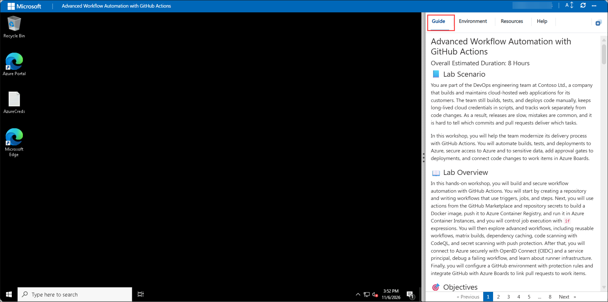

## Lab Guide Zoom In/Zoom Out

To adjust the zoom level for the environment page, click the **A↕** icon located next to the timer in the lab environment.

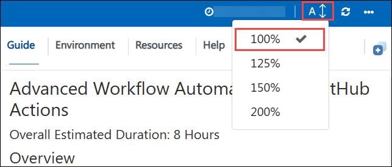

## Resize the Virtual Machine View

Use the **slider (three vertical dots)** located between the **Virtual Machine** and the **Lab Guide** panes to adjust the display size, allowing you to customize the layout based on your preference.

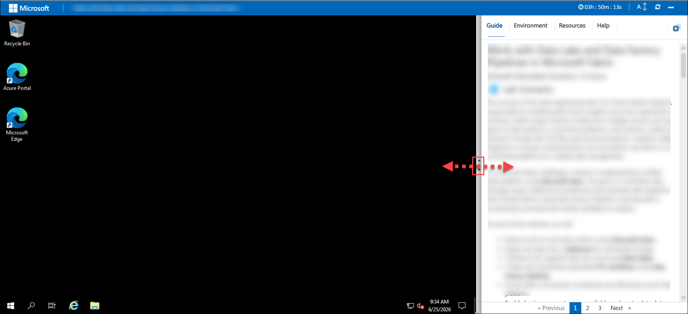

## Virtual Machine & Lab Guide

Your virtual machine is your workhorse throughout the sandbox. The lab guide is your reference for getting started.

## Exploring Your Lab Resources

To get a better understanding of your lab resources and credentials, navigate to the **Environment** tab.

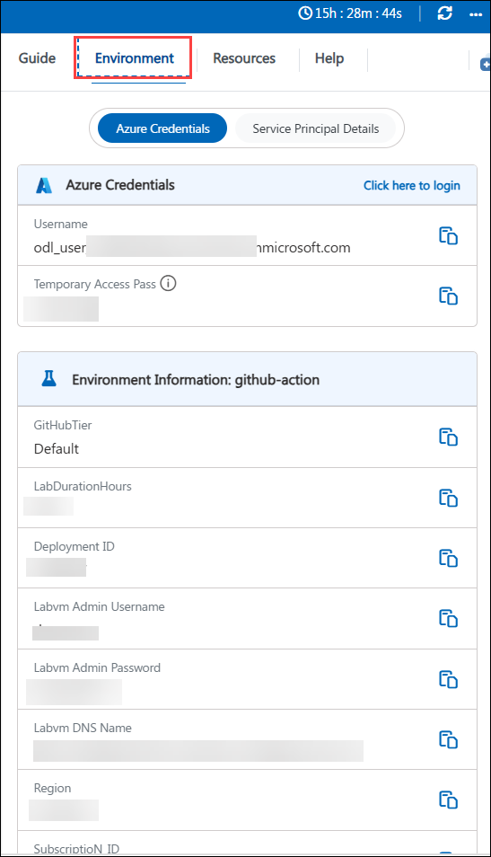

## Utilizing the Split Window Feature

For convenience, you can open the lab guide in a separate window by selecting the **Split Window** button from the top right corner.

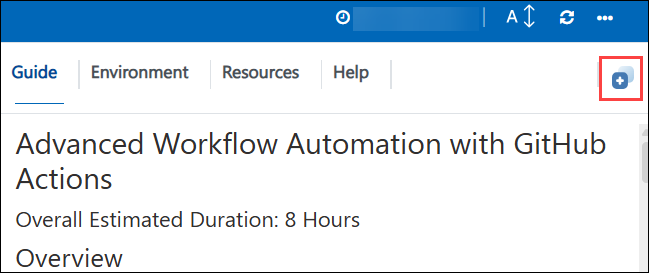

## Managing Your Virtual Machine

Feel free to **Start, Stop, or Restart** your virtual machine as needed from the **Resources** tab. Your experience is in your hands!

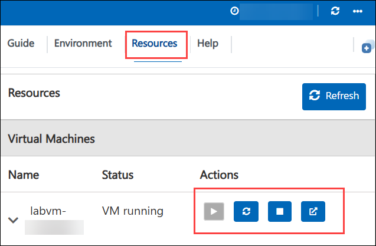

## ☁️ Get Started with Azure Portal

1. On the virtual machine, open **Microsoft Edge** and go to `https://portal.azure.com`.

1. You'll see the **Sign in to Microsoft Azure** tab. Enter the following email/username, and then select **Next (2)**.

   - **Email/Username:** <inject key="AzureAdUserEmail"></inject> **(1)**

     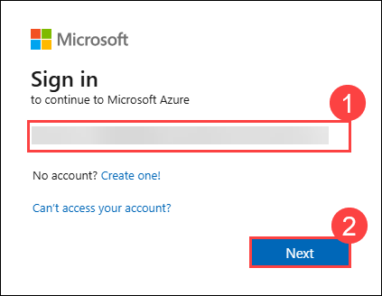

1. Next, enter the following Temporary Access Pass, and then select **Sign in (2)**.

   - **Temporary Access Pass:** <inject key="AzureAdUserPassword"></inject> **(1)**

     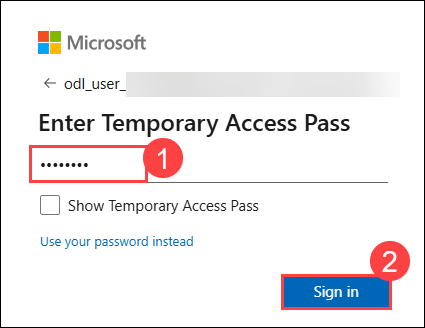

1. If prompted to stay signed in, select **No**.

   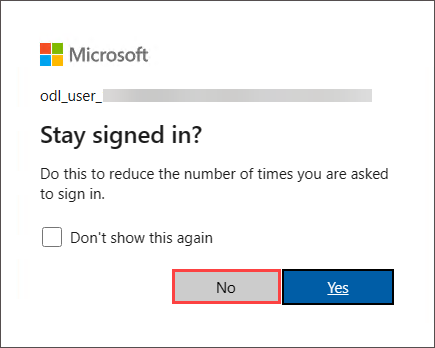

1. If a **Welcome to Microsoft Azure** pop-up window appears, select **Cancel** (or **Maybe later**) to skip the tour.

   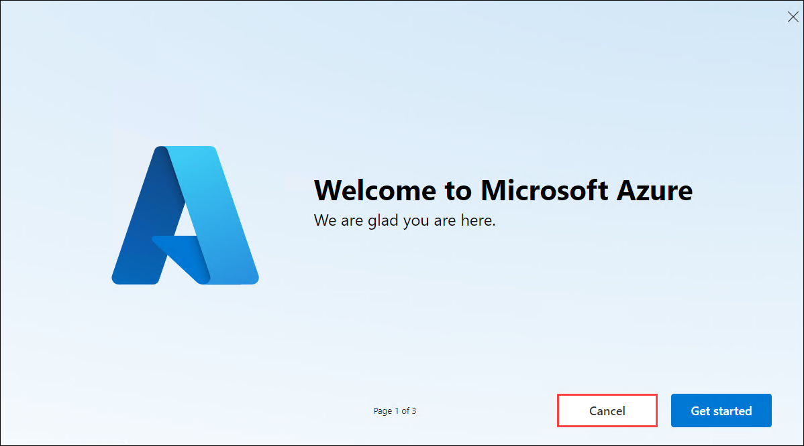

1. On the Azure portal home page, scroll to the **Navigate** section, and then select **Resource groups**.

   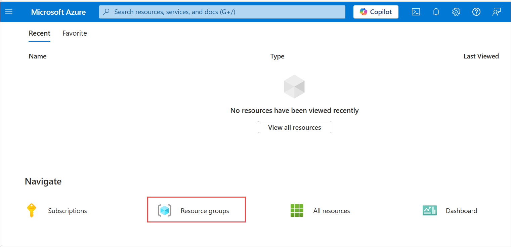

1. Open your resource group to see your virtual machine and your Fabric capacity.

## 🧵 Sign In to Microsoft Fabric

1. In **Microsoft Edge**, open a new tab and go to `https://app.fabric.microsoft.com`.

1. Sign in with the same email/username and Temporary Access Pass that you used for the Azure portal.

1. Select **Workspaces**, and then select **New workspace**.

1. Enter a name for the workspace. Under **Advanced**, select **Fabric capacity**, choose the capacity named **fabric<inject key="DeploymentID" enableCopy="false"></inject>**, and then select **Apply**.

1. Your workspace is ready. Use it to create lakehouses, warehouses, pipelines, and reports.

## 📊 Using Excel and Power BI Desktop

- **Excel:** The first time you open Excel, sign in with an account that has a Microsoft 365 Apps licence to activate it.
- **Power BI Desktop:** Sign in with your lab email/username to publish reports to your Fabric workspace.

## 🆘 Support Contact

The CloudLabs support team is available 24/7, 365 days a year, via email and live chat.

- Email Support: cloudlabs-support@spektrasystems.com
- Live Chat Support: https://cloudlabs.ai/labs-support
